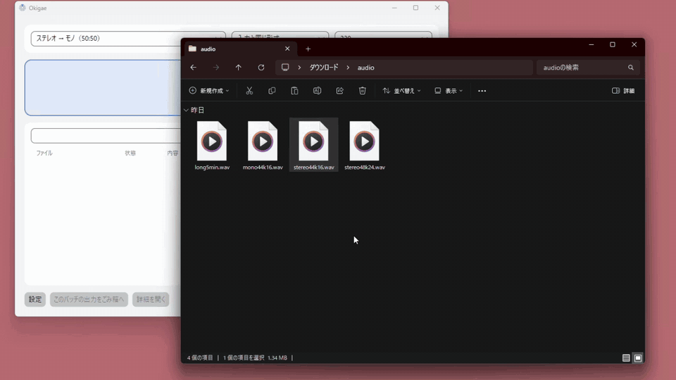
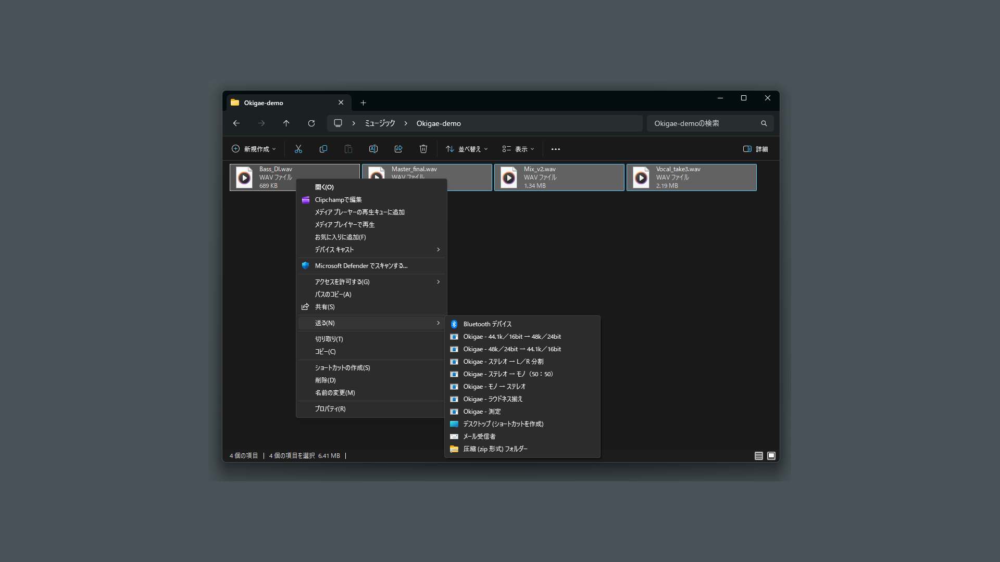
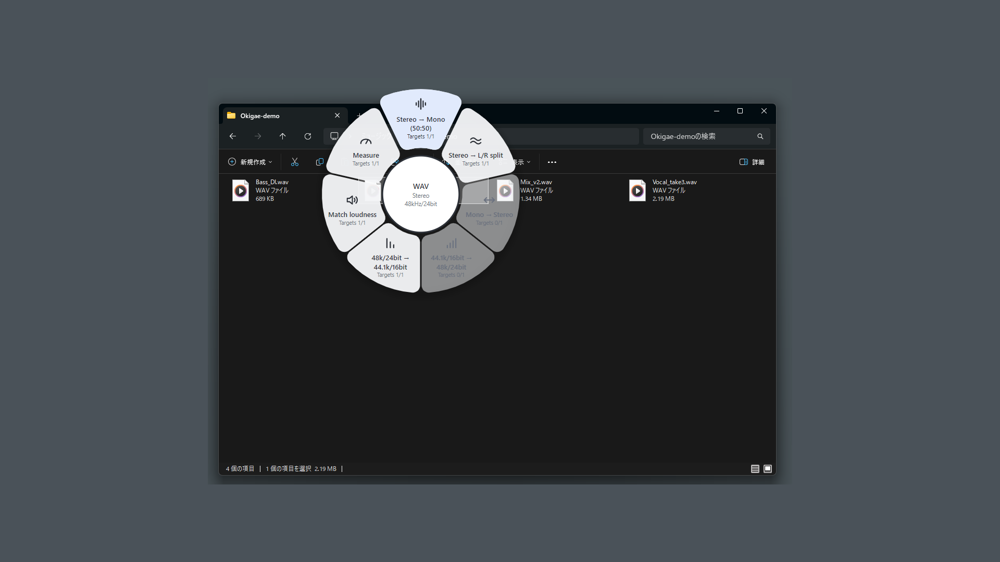
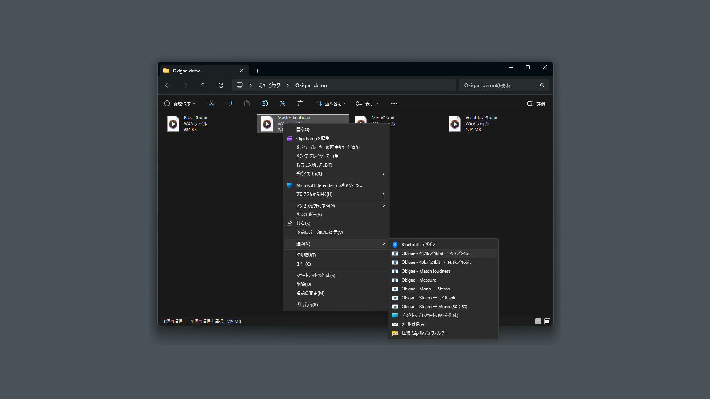

# Okigae

**日本語** ・ [English](#english)

Okigae（おきがえ）は、WAV / MP3 をかんたんに変換する Windows 用のアプリです。
エクスプローラーでファイルを **Ctrl を押しながらドラッグ** すると、カーソルのまわりにメニュー（ドーナツ）が出ます。やりたい変換の上で指を離すだけで、変換されたファイルが同じフォルダーにできます。

- 元のファイルは書き換えません。結果は別の名前で保存します。
- インターネットに接続しません。ファイルは PC の中だけで扱います。
- 無料です。

## 目次

- [できること](#できること)
- [ダウンロード](#ダウンロード)
- [はじめかた](#はじめかた)
- [使いかた](#使いかた)
- [よくある質問](#よくある質問)
- [アンインストール](#アンインストール)
- [困ったとき・連絡先](#困ったとき連絡先)

## できること

| やりたいこと | メニューの名前 | できるファイルの名前（例: `song.wav`） |
|---|---|---|
| ステレオをモノラルにする | ステレオ → モノ（50:50） | `song_mono.wav` |
| ステレオを左と右の 2 つのファイルに分ける | ステレオ → L/R 分割 | `song_L.wav`、`song_R.wav` |
| モノラルをステレオにする | モノ → ステレオ | `song_stereo.wav` |
| 48 kHz / 24 bit を CD と同じ 44.1 kHz / 16 bit にする | 48k/24bit → 44.1k/16bit | `song_44k16.wav` |
| 44.1 kHz / 16 bit を 48 kHz / 24 bit にする | 44.1k/16bit → 48k/24bit | `song_48k24.wav` |
| 音量（ラウドネス）を揃える。既定は配信サービスでよく使われる -14 LUFS | ラウドネス揃え | `song_-14LUFS.wav` |
| 音量（ラウドネス）を測るだけ。ファイルは作らない | 測定 | （結果を画面に表示） |
| WAV を MP3 に、MP3 を WAV にする | 「出力形式」で WAV / MP3 を選ぶ | `song.mp3` など |

- 複数のファイルをまとめて変換できます。
- 同じ名前のファイルがあるときは ` (2)` のように番号を付けます。上書きはしません。
- 変換に失敗したときは、作りかけのファイルを残しません。

## ダウンロード

| 版 | 入手先 | 特徴 |
|---|---|---|
| **ZIP 版**（今すぐ使えます） | [最新版をダウンロード](https://github.com/iekaradenairin/Okigae/releases/latest)（`Okigae-1.0.0-win-x64.zip`） | インストール不要。展開して起動するだけ。新しい版が出ても自動では更新されません |
| **ZIP 版（BOOTH）** | [BOOTH で無料ダウンロード](https://iekaradenai.booth.pm/items/9063918) | 上と同じ ZIP です。BOOTH のアカウントで入手したい方向け |
| **Microsoft Store 版** | 準備中 | Store から入れると自動で更新されます。公開したら、ここにリンクを載せます |

動作環境: Windows 10 / 11（64 bit）

## はじめかた

ZIP 版の手順です。

1. 上のリンクから `Okigae-1.0.0-win-x64.zip` をダウンロードします。
2. ZIP を右クリック →「プロパティ」を開きます。下のほうに「許可する」というチェックボックスがあれば、チェックを入れて「OK」を押します（無ければそのままで大丈夫です）。
3. ZIP を右クリック →「すべて展開」を選びます。展開先は「ドキュメント」など、好きな場所でかまいません。
4. できた「Okigae」フォルダーを開いて、`Okigae.exe` をダブルクリックします。
5. 初めて起動したときに「Windows の起動時に Okigae を起動しますか？」と聞かれます。いつでもドーナツを使いたいなら「はい」がおすすめです（あとで設定から変えられます）。

> **「Windows によって PC が保護されました」と出たとき**
> このアプリには署名がないため、初回に出ることがあります。「詳細情報」を押してから「実行」を押してください。

> ZIP を開いたまま、中の `Okigae.exe` を起動しないでください。必ず先に「すべて展開」してください。

## 使いかた

Okigae が起動していれば（タスクトレイにアイコンがあれば）、次の 3 つの方法で変換できます。

### 1. ドーナツ メニュー（おすすめ）

1. エクスプローラーで、WAV / MP3 ファイルを選びます（複数でも OK）。
2. **Ctrl キーを押しながら** ファイルをドラッグします。
3. カーソルのまわりにドーナツが出るので、やりたい変換の上でマウスのボタンを離します。

- ドーナツの真ん中には、ファイルの形式（例: WAV / ステレオ / 44.1kHz/16bit）が出ます。
- 各項目の「対象 1/1」は、選んだファイルのうちその変換ができる数です。変換できないもの（たとえば、もうモノラルのファイルに「ステレオ → モノ」）は灰色になって選べません。
- Ctrl の代わりに Alt を使うように、設定で変えられます。

### 2. 右クリックの「送る」

ファイルを右クリック →「送る」→「Okigae - …」から、やりたい変換を選びます（Windows 11 では、右クリックのあと「その他のオプションを確認」の中にあります）。

一度に送れるのは 100 件くらいまでが目安です。それより多いときは、ドーナツかウィンドウへのドロップを使ってください。

### 3. ウィンドウにドロップ

Okigae のウィンドウ（タスクトレイのアイコンから開けます）の上の欄で変換の内容を選び、ファイルをウィンドウにドロップします。結果の一覧もここで見られます。「このバッチの出力をごみ箱へ」で、いま作ったファイルをまとめてごみ箱に入れることもできます。

## よくある質問

**変換したファイルはどこにできますか？**
元のファイルと同じフォルダーにできます。名前の後ろに `_mono` などが付きます。

**元のファイルは消えたり変わったりしますか？**
いいえ。読み取るだけで、書き換えも削除もしません。

**キーやマウスを見ているのが気になります。**
ドーナツを出すために、マウスのドラッグと、Ctrl / Alt キーが押されているかだけを見ています。入力した文字は記録も保存も送信もしません。気になるときは、設定で「ドーナツを有効にする」をオフにしてください（オフにすると、見るのもやめます）。「送る」とウィンドウへのドロップは、ドーナツが無くても使えます。

**ウイルス対策ソフトが反応しました。**
上と同じ理由で、マウスとキーを見るしくみ（Windows のフック）に反応することがあります。心配なときは、ドーナツをオフにして使ってください。

**ドーナツが出ません。**
タスクトレイに Okigae のアイコンがあるか（起動しているか）、設定で「ドーナツを有効にする」がオンか、起動キー（Ctrl / Alt）が合っているかを確かめてください。管理者として動いているアプリの上では出ないことがあります。

**インターネットに接続しますか？**
しません。詳しくは [プライバシー ポリシー](https://iekaradenairin.github.io/Okigae/privacy/) を見てください。

## アンインストール

ZIP 版は、フォルダーを消す前に、次の手順でアンインストールしてください（先にフォルダーを消すと、「送る」の項目が残ってしまいます）。

1. Okigae のウィンドウで「設定」を開き、左下の「アンインストール…」を押します。
2. 「設定・履歴・ログも消す」にチェックが入っていることを確かめて、「アンインストール」を押します。「送る」の項目と、Windows の起動時に開始する設定も消えます。
3. 最後に開くフォルダー（Okigae を展開したフォルダー）を、手で削除します。

## 困ったとき・連絡先

- 質問・不具合の報告: [Issues](https://github.com/iekaradenairin/Okigae/issues) に書くか、メール（iekaradenai.support.rin@gmail.com）でお知らせください。
- 不具合のときは、設定の左下の「ログを書き出す」で作られる `Okigae-report-日時.zip`（デスクトップにできます）を添えてもらえると助かります。ZIP の中では Windows のユーザー名を伏せていますが、変換したファイルとフォルダーの名前は残ります。気になるときは、送る前に中身を確かめてください。
- [プライバシー ポリシー](https://iekaradenairin.github.io/Okigae/privacy/)
- ライセンス: Okigae には FFmpeg（LGPL）などのオープンソース ソフトウェアが入っています。ライセンスの全文とソースは、ZIP の中の `licenses\` と `sources\` にあります。

---

# Okigae (English)

[日本語](#okigae) ・ **English**

Okigae is a simple WAV / MP3 converter for Windows.
In File Explorer, **hold Ctrl and drag** your files: a menu (the "donut") appears around the cursor. Release the mouse button over the conversion you want, and the result appears in the same folder.

- Your original files are never changed. Results are saved under a new name.
- Okigae does not connect to the internet. Your files stay on your PC.
- It is free.

(The animation at the top of this page shows the Japanese interface. Okigae uses English when Windows is not set to Japanese.)

## What it can do

| What you want | Menu item | Result (for `song.wav`) |
|---|---|---|
| Make a stereo file mono | Stereo → Mono (50:50) | `song_mono.wav` |
| Split a stereo file into left and right files | Stereo → L/R split | `song_L.wav`, `song_R.wav` |
| Make a mono file stereo | Mono → Stereo | `song_stereo.wav` |
| Convert 48 kHz / 24-bit to CD-quality 44.1 kHz / 16-bit | 48k/24bit → 44.1k/16bit | `song_44k16.wav` |
| Convert 44.1 kHz / 16-bit to 48 kHz / 24-bit | 44.1k/16bit → 48k/24bit | `song_48k24.wav` |
| Match the loudness. The default is -14 LUFS, common on streaming services | Match loudness | `song_-14LUFS.wav` |
| Only measure the loudness (no new file) | Measure | (shown on screen) |
| Turn WAV into MP3, or MP3 into WAV | Choose WAV or MP3 as the output format | `song.mp3`, etc. |

- You can convert many files at once.
- If a file with the same name exists, a number such as ` (2)` is added. Nothing is overwritten.
- If a conversion fails, no half-written file is left behind.

## Download

| Version | Where | Notes |
|---|---|---|
| **ZIP version** (available now) | [Download the latest release](https://github.com/iekaradenairin/Okigae/releases/latest) (`Okigae-1.0.0-win-x64.zip`) | No installation: extract and run. It does not update itself |
| **ZIP version (BOOTH)** | [Free download on BOOTH](https://iekaradenai.booth.pm/items/9063918) | The same ZIP as above, for those who prefer to get it through BOOTH |
| **Microsoft Store version** | Coming soon | Updates automatically through the Store. The link will be added here once it is published |

Requires Windows 10 / 11 (64-bit).

## Getting started

These steps are for the ZIP version.

1. Download `Okigae-1.0.0-win-x64.zip` from the link above.
2. Right-click the ZIP and open "Properties". If there is an "Unblock" checkbox near the bottom, tick it and press "OK" (if not, that is fine).
3. Right-click the ZIP and choose "Extract All". You can extract it anywhere, for example to Documents.
4. Open the "Okigae" folder that was created and double-click `Okigae.exe`.
5. The first time, Okigae asks whether to start when Windows starts. Choose "Yes" if you want the donut menu to be always ready (you can change this later in Settings).

> **If you see "Windows protected your PC"**
> Okigae is not code-signed, so this can appear the first time. Press "More info", then "Run anyway".

> Do not run `Okigae.exe` from inside the ZIP. Always choose "Extract All" first.

## How to use it

While Okigae is running (its icon is in the notification area of the taskbar), there are three ways to convert.

### 1. The donut menu (recommended)

1. In File Explorer, select WAV / MP3 files (one or many).
2. **Hold Ctrl** and drag the files.
3. A donut appears around the cursor. Release the mouse button over the conversion you want.

- The center of the donut shows the format of the files (for example: WAV / Stereo / 44.1kHz/16bit).
- Each item shows how many of the selected files it can convert. Items that cannot apply (for example "Stereo → Mono" for a file that is already mono) are grayed out.
- You can switch the key from Ctrl to Alt in Settings.

### 2. "Send to" in the right-click menu

Right-click files → "Send to" → "Okigae - …" and choose the conversion. (In Windows 11, "Send to" is under "Show more options" after you right-click.)

"Send to" handles up to about 100 files at a time. For more, use the donut menu or drop the files onto the window.

### 3. Drop files onto the window

Open the Okigae window (from its icon in the notification area), choose the conversion at the top, and drop files onto the window. The results are listed there. "Move this batch's output to the Recycle Bin" sends the files you just made to the Recycle Bin.

## FAQ

**Where do the converted files go?**
Into the same folder as the original, with something like `_mono` added to the name.

**Are my original files changed or deleted?**
No. Okigae only reads them.

**Why does it watch the keyboard and mouse?**
To show the donut, it only watches mouse dragging and whether Ctrl / Alt is held. It does not record, save or send what you type. If you prefer, turn off "Enable the donut menu" in Settings; the watching then stops. "Send to" and dropping onto the window still work without the donut.

**My antivirus software reacted.**
For the same reason, some antivirus software reacts to the way Okigae watches the mouse and keys (a Windows hook). If you are concerned, turn off the donut menu.

**The donut does not appear.**
Check that Okigae is running (its icon is in the notification area), that "Enable the donut menu" is on in Settings, and that you are holding the right key (Ctrl or Alt). It may not appear over apps running as administrator.

**Does it connect to the internet?**
No. See the [privacy policy](https://iekaradenairin.github.io/Okigae/privacy/).

## Uninstall

For the ZIP version, uninstall before deleting the folder (if you delete the folder first, the "Send to" items stay behind).

1. In the Okigae window, open "Settings" and press "Uninstall..." at the bottom left.
2. Make sure "Also delete the settings, history and logs" is ticked and press "Uninstall". The "Send to" items and the start-with-Windows setting are removed too.
3. Finally, delete by hand the folder that opens (the folder you extracted Okigae to).

## Help and contact

- Questions and bug reports: open an [issue](https://github.com/iekaradenairin/Okigae/issues), or email iekaradenai.support.rin@gmail.com.
- For a bug, it helps to attach `Okigae-report-<date and time>.zip`, which "Export the log" at the bottom left of Settings creates on your desktop. Your Windows user name is hidden in it, but the names of converted files and folders are kept. If that bothers you, look inside before sending it.
- [Privacy policy](https://iekaradenairin.github.io/Okigae/privacy/)
- Licenses: Okigae includes FFmpeg (LGPL) and other open-source software. The full license texts and source code are in the `licenses\` and `sources\` folders of the ZIP.
